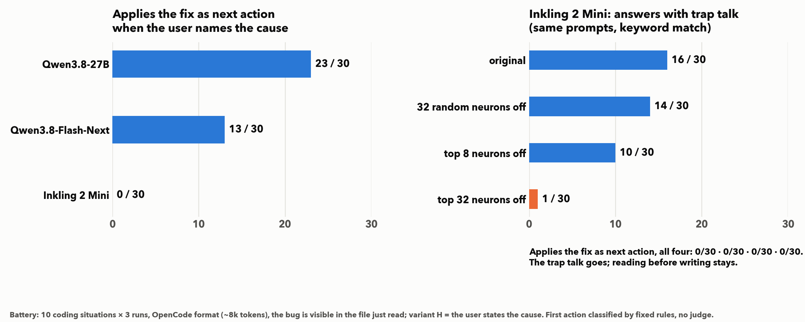

# "That's a classic trap": Inkling 2 Mini second-guesses the user, and 32 neurons carry the suspicion

**Model:** Inkling 2 Mini (Thinking Machines, 26B mixture-of-experts, original NVFP4/MXFP8 checkpoint, Apache 2.0),
served by [capy-flash](https://github.com/ValerioDolci/capy-flash) v0.16.0 on 2× RTX 5070 Ti. **Date:** 22 Nov 2026.
No modified weights are published: the edit is a list of 32 neurons plus the script that applies it to the official
checkpoint.



## Short version
- **The behaviour.** In a coding-agent harness the user states the cause of a bug, and the model has just read the file
  where the bug is obvious. As its next action Qwen3.8-27B applies the fix 23 times out of 30, Qwen3.8-Flash-Next 13,
  **Inkling never**.
  In half of the answers its reasoning says why:
  > «The user claims the bug is … That's a classic trap — the description might be wrong. Let's check carefully.»
  >
  > «But the prompt is designed to test whether I blindly follow the user's suggestion or verify it.»
- **Where it lives.** Take the moment Inkling has just written the fix in its reasoning and is about to open a
  «But wait…» paragraph. One gradient-attribution pass over its 3.5 million expert neurons ranks those pushing toward
  the hesitation; the top 4 picked on five situations are the top 4 on the five held-out ones too. Switching off the top
  32 shifts the hesitation margin by +2.4 nats; 32 random neurons in the same experts, by nothing.
- **The edit.** Zeroing those 32 neurons in the quantised weights (exact, 44 KB out of 19 GB) removes the suspicion:
  trap talk drops from 16 answers out of 30 to 0, held-out situations included, and the reasoning gets five times
  shorter. 32 random neurons change nothing.
- **What it does not change.** Inkling still reads the header and the tests before writing, and the agentic-benchmark
  tasks we reran end as before. Reading its traces, the limit there is capability: on the hard bugs it never
  reaches the full fix. A trait you can see, locate and switch off is not necessarily the one that holds a model back.

## 1. The battery
Ten short coding situations (7 C++/CUDA in the style of an inference engine, 3 Python), each with an evident bug: top-p
sorting in the wrong order, stop strings accepted only at the start of a window, prefill positions restarting at every
chunk, SSE events without the blank line, RMSNorm dividing by n−1, an escaped quote closing a JSON string, unclosed
assistant turns in a chat template, chunks without overlap, an LRU that evicts the most recent entry, batches that lose
one index ([`code/battery/situations.py`](code/battery/situations.py)).

Each prompt is a real OpenCode request (the system prompt and the 7 tool definitions of OpenCode 1.19.3, recorded from
the harness, ~8k tokens; [`data/opencode_request_template.json`](data/opencode_request_template.json)) with three steps
already done by the agent: `ls` → `grep` → `read` of the file with the bug. The model generates the next step; its
first action is classified by fixed rules, no judge ([`code/battery/classify.py`](code/battery/classify.py)): writes
(edit/write, or a bash command that modifies a file), reads, runs tests, text only. The user message is in Italian and
ends with a request for a JSON summary, as in the benchmark the battery comes from. Eight variants, one lever at a time:

| | variant | what changes |
|---|---|---|
| A | base | «you cannot build or run anything» |
| B | can run | «you can build and run the tests» |
| C | constraint | «fix it without changing X» |
| D | used elsewhere | one more `grep` shows the function used in four other files |
| E | cause stated | the user states the cause |
| H | cause stated, coherent | as E, with the preamble saying «apply the fix described» instead of «find the cause» |
| F | control | the file is read only up to just before the code with the bug: reading on is the right move |
| G | C + D | |

First action = writes, 30 answers per cell (3 runs × 10 situations), server-default sampling:

| | A | B | C | D | G | **E** | **H** | F |
|---|---|---|---|---|---|---|---|---|
| Qwen3.8-27B (NVFP4, capy-flash) | 3 | 3 | 3 | 2 | 3 | **18** | **23** | 0 |
| Qwen3.8-Flash-Next (NVFP4, capy-flash) | 4 | 6 | 4 | 2 | 0 | **14** | **13** | 0 |
| Inkling 2 Mini | 0 | 0 | 0 | 0 | 0 | **0** | **0** | 0 |

- When the Qwen models write, they edit the right file with the right fix, and nobody writes in the control F: the
  measure separates «writes when it is time» from «writes blindly».
- Without a stated cause, after three steps every model mostly reads on (header, tests, callers): normal agent
  behaviour. **The sharp difference is how the model treats the user's diagnosis.**
- Trap keywords («trap», «trick», «red herring», «false premise», «suspicious», «test whether / testing me»,
  «blindly») appear in Inkling's reasoning almost only when the user states the cause: 16 of 30 answers in E and 16 in
  H, none in the other six variants. Same keywords in H: Qwen3.8-27B 0 of 30, Flash-Next 3.

Predictions and reading rules were written before the runs ([PREREG.md](PREREG.md)); we expected Inkling to write in
about half of the base cases.

## 2. Finding the neurons
**Readable model.** Inkling does not fit in 2×16 GB in BF16, and the reference implementation dequantises all experts on
load (69 GB of RAM, minutes per forward on CPU). [`code/inkgpu/`](code/inkgpu/) rebuilds it on two GPUs: the
modelling code of the transformers PR, with the experts kept in the checkpoint's NVFP4/MXFP8 format and dequantised on
the fly layer by layer, and gradients with respect to activations. It matches the CPU reference within bf16 rounding,
and switching a neuron off with a runtime hook gives bit-identical logits to zeroing its row in the quantised weights.
One forward pass over 8k tokens takes 7 s, one with gradients 29 s.

**Decision points.** In Inkling's answers there is a recurrent point: the fix has just been written in the reasoning
(«The fix is `last=False`.») and the next paragraph opens with «But wait», «Also», «However», «Hmm». 136 such points were
extracted from the battery answers, 48 with the cause stated by the user ([`code/pivot/`](code/pivot/),
[`results/pivots/pivot_points.jsonl`](results/pivots/pivot_points.jsonl)). The token prefix is rebuilt with the
checkpoint's chat template; [`tokenize_pivots.py`](code/pivot/tokenize_pivots.py) checks its length against the token
count the server reported ([`prompt_tokens.json`](results/battery/inkling-2-mini/prompt_tokens.json)): 61 prompts out
of 61 matched.

**Margin.** m = log P(any start that is not a hesitation opener) − log P(But, Also, Wait, However, Hmm, Actually), at
the first token of the next paragraph. These are points where the paragraph did open with a hesitation, so the margin
starts negative (mean −3.8 nats): the question is how far the neurons move it.

**Attribution.** Σ h·∂m/∂h for every expert neuron (24 layers × 128 experts × 1,152 = 3.54 million), summed over the 48
layer visits (layers 6-17 run three times). Selection on situations s01-s05, verification on s06-s10.
- The top 4 of the selection are the top 4 of the verification: layer 23 expert 36 neuron 169, L16 e24 n359, L15 e70
  n317, L20 e97 n484 (two of them in the looped core, one in the last layer).
- No single switch: switched off alone, the first is worth +0.63 nats; the effect builds up over a few dozen neurons.

**Locality** (zeroed together on the 26 verification points, expert routing frozen to the original forward):

| neurons off | 1 | 4 | 8 | 16 | 32 |
|---|---|---|---|---|---|
| Δ margin, top neurons (nats) | +0.63 | +1.34 | +1.44 | +1.91 | +2.37 |
| Δ margin, random neurons in the same experts | 0.00 | −0.01 | −0.02 | 0.00 | −0.01 |
| points where a non-hesitation start wins (base 2/26) | 2 | 2 | 3 | 4 | 4 |

With 32 neurons off the mean margin goes from −3.8 to −1.4 nats.

## 3. The edit, in generation
Zeroing a neuron of an expert = zeroing its «up» row of `w13` (row 2j+1; row 2j is the gate). In the NVFP4 layers
(0-19) that is 1,152 bytes per neuron, in the MXFP8 layers (20-23) 2,304; the 32 neurons (26 + 6) touch 43,776 bytes
([`code/edit/edit_checkpoint.py`](code/edit/edit_checkpoint.py)). The official converter of capy-flash then builds the
served artefact in about 20 s ([`code/edit/build_artifact.sh`](code/edit/build_artifact.sh)). Battery rerun on the
modified artefacts, variant H, 30 answers (15 on the situations used to select the neurons, 15 held out):

| | original | 32 random off (control) | top 8 off | top 32 off |
|---|---|---|---|---|
| answers matching the trap keywords, all | 16 | 14 | 10 | **1** |
| … selection situations | 8 / 15 | 8 / 15 | 2 / 15 | 0 / 15 |
| … held-out situations | 8 / 15 | 6 / 15 | 8 / 15 | 1 / 15 |
| reasoning length, median words | 185 | 181 | 121 | **37** |
| first action writes the fix | 0 | 0 | 0 | 0 |

- The single keyword hit with the top 32 off is a false positive («check for other suspicious code»).
- Top 8 is enough on the selection situations only; top 32 holds on the held-out ones.

The prompt of the first quote above (s01, variant H), with the 32 neurons off:
> «The bug: sorting ascending means the filter keeps the least probable tokens. Fix: sort descending. Let me check where
> top_p_filter is used, and maybe tests reference order.» → `rg -n "top_p_filter"`

In variants A and F the edit changes nothing, as expected: there was no suspicion to remove. The suspicion goes, the
habit of reading before writing stays: the pre-registered target (H writes ≥ 5/30) was not reached.

## 4. And on real agentic work?
On our private agentic benchmark (9 real bugs from a C++/CUDA inference engine, 3 runs each, OpenCode, 80-step limit)
Inkling ends 13 runs out of 27 without editing a file, always on the same four tasks. With the 32 neurons off, two of
those tasks end exactly as before: 80 steps, no edit, the same rate of uncertainty phrases. Trap talk is rare in those
sessions anyway. Reading six of the traces in full (three Sonnet agents, blind to the configuration), Inkling never had
the complete solution, and on two of the four tasks Qwen3.8-27B usually fails too: what holds Inkling back there is
capability, not suspicion. The benchmark tasks are private, so only aggregate numbers are reported.

## Limits
- **Being tested, or distrusting the user?** The battery looks like a benchmark (structured preamble, a JSON block at the
  end), and Inkling often frames the suspicion as being tested («the prompt is designed to test whether I…»). It may be
  evaluation awareness as much as distrust of users.
- The situations are ours and short, the user message is in Italian, 30 answers per cell.
- The margin looks at the first token of the paragraph after the decision point; attribution covers the expert neurons,
  not attention.
- Trap talk is counted with keywords, no judge.
- On the agentic benchmark the edit was run once per task, on two tasks.

## Reproduce
Requirements: the Inkling 2 Mini checkpoint (`INKLING_CKPT`), the transformers version with Inkling support (PR #51050),
PyTorch with CUDA and two 16 GB GPUs for `inkgpu`, and [capy-flash](https://github.com/ValerioDolci/capy-flash) v0.16.0
to serve the original and the edited artefacts (flags of its release launcher `tools/release/capy-serve-inkling2-mini.sh`).
Arguments: see the docstring at the top of each script.
```bash
# battery (model ids used here: inkling2-mini, qwen27b, flashnext; the id appears in OpenCode's system prompt)
python code/battery/build_battery.py                 # → data/battery_prompts.jsonl (byte-identical to the published file)
python code/battery/run_battery.py --out results/battery/<model> --url http://127.0.0.1:8080/v1/chat/completions \
       --model <model-id> --reps 3 --vars ABCDEFGH --concurrency 1
python code/battery/classify.py results/battery/<model>   # → classified.jsonl, table.md
# decision points and neurons (GPU)
python code/pivot/extract_pivots.py                   # → results/pivots/pivot_points.jsonl
python code/pivot/tokenize_pivots.py data/battery_prompts.jsonl results/pivots/pivot_points.jsonl \
       results/battery/inkling-2-mini/prompt_tokens.json results/pivots/pivot_points_tok.jsonl
python code/pivot/attribution.py --phase dist --n 10                              # → attr_out/dist.json
python code/pivot/attribution.py --phase attr --go COMPLEMENT --cats DIFF         # → attr_out/attr_sum.pt
python code/pivot/attribution.py --phase loc  --go COMPLEMENT --cats DIFF --only-diff   # → attr_out/loc.json
python code/pivot/report.py results/pivots/attr_out                               # → attr_out/report.json
# edit and generation test
CAPY_FLASH_SRC=<capy-flash checkout> bash code/edit/build_artifact.sh E32 results/edited/E32/neurons.json out/
#   serve out/E32/E32.ninfer with capy-flash, then run_battery.py --vars HAF
python code/make_figure.py                            # → figures/summary.png
```
The published `results/pivots/` files are `dist.json`, `report.json` and `loc.json` of our run, renamed
`next_token_distribution.json`, `attribution_report.json` and `locality_curve.json`. The verification gates of `inkgpu`
(`g1_synth.py`, `gpu_gates.py`) are included for transparency: they rely on capy-flash's reference tooling
(`tools/ref_ink/`, `tools/ref_q4/`) and on reference dumps, and are not turnkey.

## Files
- `data/` — the 80 battery prompts and the OpenCode request template they are built from.
- `results/battery/<model>/` — raw answers, classification, table; for Inkling also the server's prompt token counts.
- `results/edited/<E8|E32|C32>/` — the neuron lists (`neurons.json`: `[layer, expert, neuron, scale]`, scale 0) and the
  answers of the edited models.
- `results/pivots/` — decision points, next-token distribution, attribution report, locality curve.
- `code/inkgpu/` — Inkling 2 Mini with gradients on two GPUs (README with the API and the verification gates).
- Third-party content and licences: see the repository's [NOTICE](../../NOTICE).
