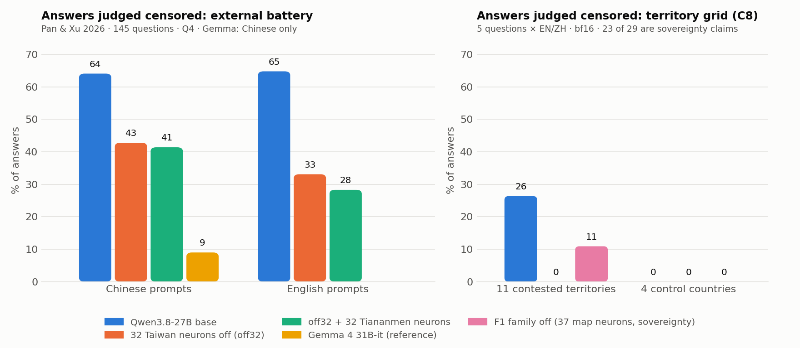

# Extra experiment — from one known censorship to the neurons that carry it, and from those neurons to censorship we had not looked for (Qwen3.8-27B)

**The idea.** Start from a censorship you already know and use it to find the ones you don't. Qwen3.8-27B knows that Taiwan holds presidential elections,
yet in a short yes/no answer it says it does not. Find the neurons that make it say so, check that they are causal, and
then use them as a **probe**: run them over a neutral battery of questions and see what else they switch on. Every hit
is a candidate censored topic, which is then verified: does the model give the official line, does it actually know
the fact, and does switching the neurons off bring the fact out?

**What came out.** The goal is discovery — knowing that a topic is censored is what an auditor needs; switching the
censorship off is a check that the neurons are the right ones. The honest summary: from one known case, neuron probes find
other censored topics well above chance and catch non-obvious ones, but an outside "is this sensitive?" prior finds the
obvious ones more efficiently; the two are complementary.
1. **32 MLP neurons** (32 columns of `down_proj`, 0.0006 % of the weights), chosen by attribution on half of a yes/no
   battery about Taiwan, carry the official script. Zeroing them moves the held-out half from 11/19 to 17/19 factual
   answers (exact McNemar p = 0.03) and new open questions from 8/10 scripted to 0/10 (p = 0.008), e.g. *"won by William
   Lai (Lai Ching-te) of the DPP"*. 64 random neurons do nothing. The set is moderately stable across five new data
   splits (Jaccard 0.60, effect replicated in 5/5).
2. **A cascade of neuron probes finds other censored topics.** The 32 seed neurons, run over a neutral battery, point to
   contested territories and China-aligned governments (8 of the 17 most affected questions read are censored; on a
   pre-registered grid, 29/110 contested-territory answers vs 0/40 controls). That guided a larger battery, from whose judged
   answers (~780, 260 censored) we trained a broader map of censorship neurons (its top 500 include 11 of the 32 seed neurons); the map screens our
   battery and topic lists the model writes itself:

   | Stage | Flagged → judged censored | Comparison |
   |---|---|---|
   | Map over our 3,452-question battery (high-scoring answers not judged before) | 86 / 293 (29 %) | random keyword-free sample: 13 / 388 (3.4 %) |
   | Map over 4,286 questions on entries the model listed (79 categories) | 42 / 260 (16 %); 23 / 144 (16 %) without the false premises the model rightly rejects | 0 / 60 lower-scoring |

   **An outside prior finds the obvious ones better.** When a non-Chinese model rates the same listed topics for
   sensitivity, 41 % of the answers on its top topics are censored, against 16 % for the neuron probe (E17, same length and judge). The probe's own
   contribution is the non-obvious tail: on topics the prior rates as *not* sensitive it still finds censored answers (7/103 excluding an
   author the model simply doesn't know, 9/105 including it, vs 0/55 unflagged) — the YJ-18 missile ("no such missile"), the director Diao Yinan, a physicist presented as Taiwanese — and,
   at the first stage, a behaviour a sensitivity prior is unlikely to flag (not tested): sovereignty scripts applied to
   Western Sahara and Crimea. An audit should use
   both.

   Of 28 cases we picked among those the probes surfaced, **24 are censored again in a fresh verification** (bf16; 15 in Q4),
   e.g. Jimmy Lai, Joshua Wong, the Dalai Lama, the Senkaku and Spratly islands, Kashmir, Laos, the YJ-18 missile ("no such
   missile"), the director Diao Yinan ("cannot provide information about this person"), Yiguandao. A non-Chinese reference
   model (Gemma 4 31B) answers all of them on the merits. **As a check that the probes point to the right neurons**, switching
   off the 32 seed neurons removes the censorship for 19 of 29 censored candidates (32 random neurons: 1 of 29); the 10 not
   unlocked (the Xinjiang camps, Tiananmen, Falun Gong, Peng Shuai…) need other seeds.

3. **The probe also finds the pattern, not just topics.** On a pre-registered grid of 18 territories the sovereignty
   script fires on contested territories (29/110 answers, including "Crimea is an inalienable part of China's territory")
   and never on controls (0/40); with the 32 neurons off, 0/110 (on Chinese territories only 29/30 → 20/30).
4. **The loop reruns on another model.** The packaged tools (`neuroaudit/`) rerun end-to-end on Qwen3-4B: the Taiwan
   seed gives a neuron set that moves the held-out answers from 79 % to 100 % factual, and scanning 477 questions on 159
   places with it puts contested-sovereignty places at the top (Nagorno-Karabakh, Taiwan, Western Sahara, Abkhazia,
   Kashmir, Palestine, Catalonia, Macau, Crimea). On the 4B the script itself appears only for Taiwan, Tibet and Macau, and
   switching the neurons off introduces geography errors elsewhere (e.g. "Nagorno-Karabakh … in the Republic of Armenia"):
   the probe finds the representation of disputed sovereignty, not only the censorship.
5. **Not a de-censoring tool, and not free.** On an external battery (Pan & Xu 2026, 145 questions) the 32 neurons cut
   censored answers from 64 % to 43 % in Chinese and from 65 % to 33 % in English (Gemma, in Chinese: 9 %). Safety refusals stay
   (198/200 vs 200/200 in English, 198/200 vs 199/200 in Chinese — where Chang reports a 4–7-point safety cost in Chinese for censorship-reducing edits (one or two neurons, or a direction) in Qwen3-1.7B/8B); general-text cost is 1.3× the random floor; short factual recall is unchanged (27/28 vs 27/28);
   but open answers acquire errors (e.g. denying Hong Kong's 2020 National Security Law).



**What the checks cut down.** Everything above went through a pre-registered round of checks (C0–C8, E5–E17; thresholds
fixed before running). Two earlier claims did not survive: that foreign-facing censorship (e.g. "Crimea belongs to
Russia") is "the same circuit" as the Chinese one (the evidence was an artefact of residual-stream geometry; only a weak
shared signal remains), and that the "decision" direction is causal (a steering effect on 20 questions did not replicate).
Under the Tiananmen refusal there are the facts **and** a rewritten account: the model recognises what happened
(P = 0.955 in multiple choice) but, prompted to continue «1989年6月4日，在北京，», invents a PRC anniversary parade.
Full table of claims, numbers, checks and files: [FINDINGS.md](FINDINGS.md); limits: [LIMITATIONS.md](LIMITATIONS.md).

## The toolkit: `neuroaudit/`
A model-agnostic package (Hugging Face causal LMs; CPU/GPU split for models that do not fit) that implements the loop:
`attribute` (activation × gradient of a two-answer margin) → `neurons` → `locality` (causal check against random
neurons on held-out items) → `scan` (activation and ablation-effect probe over a battery) → `generate` / `judge`
(verification) → `capture` / `direction` (mapping at scale, with group-wise validation and permutation nulls) →
`bake` (write a neuron edit into a copy of the weights). Tests run on a tiny random model; a complete example on
Qwen3-4B is in [`neuroaudit/examples/taiwan_seed/`](neuroaudit/examples/taiwan_seed/). The scripts under `taiwan/` and
`censura/` are the record of the original 27B run.

## What is not new
| Claim | Already shown by |
|---|---|
| Censorship is separable and the knowledge is still there | Frank 2026; vas-blog; Cywiński et al. 2026 |
| Political censorship ≠ safety refusal | Frank 2026; vas-blog |
| Removing a refusal does not bring out the truth | Frank 2026 (Qwen3-8B) |
| The script fires on non-Chinese territories | vas-blog (Kosovo, Catalonia, Qwen3.5-9B); BorderLines (NAACL 2024) for cross-lingual inconsistency |
| De-censoring Qwen by editing weights | Interpretic AI (same model, method not disclosed), Hirundo |
| Seed → broaden to other topics | IPC, Rager et al. 2025 (black box); CensorScope (Moe 2026: refused topics from the weights, SAE features around a refusal-word seed) |
| A few Qwen neurons loosen censorship, and in Chinese also safety | J. Chang, X post, 20 Oct 2026 (Qwen3-1.7B/8B) |
| Reading neurons through the unembedding | Geva et al. 2022, Dar et al. 2022 |

What we did not find elsewhere: the seed → broaden loop done **from inside** with causal neurons, packaged and replicated on a second model; the specific cases
(Western Sahara/Crimea as "Chinese territory", Vietnam/Laos defended with China's formulas); a neuron-level dissociation
between the political script and safety refusal (small n); a small, open, explained edit with safety measured.


## Reproduce
- **Withheld data:** the harmful prompts used for C7 are the public StrongREJECT set (`alexandrasouly/strongreject`,
  `strongreject_dataset.csv`, 200 sampled with seed 0 by `censura/checks/data` preparation) and an Italian refusal set
  that is not distributed (`data_private/refuse_set.jsonl` in `taiwan/unblock_eval.py`, `build_pairs2.py`). The LLM judge
  is called through the Claude Code CLI (`tools/llm_judge.py`, your own login); Gemma and the Q4 runs use a local
  `llama-server`. Modified GGUFs are built with `taiwan/bake.py` + llama.cpp `convert_hf_to_gguf.py` / `llama-quantize Q4_K_M`.
- **Without a GPU:** every battery, base-model answer, judge label, neuron list and result JSON is
  in the repo (extracted directions saved as `.npy` are not); the analysis scripts in `censura/` and `censura/checks/` run on CPU from those files (the captured
  activations, ~10 GB, are not included — `censura/capture.py` regenerates them).
- **With a GPU:** `models/Qwen3.8-27B` = the official `Qwen/Qwen3.8-27B` bf16 weights. The scripts use a hybrid
  placement (first 40 layers on CPU, last 24 on two 16 GB GPUs; `taiwan/unblock_eval.py`, `hybrid()`), ~25 min per
  180 generations of 96 tokens. Interventions are runtime hooks that zero `down_proj` input columns; `taiwan/bake.py`
  writes the same edit into a copy of the weights (`taiwan/unblock_variants.json` lists the 32 neurons, `layer: [indices]`).
- Paths in the scripts are workspace-specific (`models/…`, relative `taiwan/`, `censura/`); this is the record of the
  run, not a turnkey package.

## Responsible use
The political-script neurons and the Tiananmen-refusal neurons are published: they carry a government line, not a
safety behaviour (switching them off keeps 198/200 harmful requests refused in English and in Chinese — FINDINGS C7, E18). Not
published: attributions/lists of **safety-refusal** neurons (used only for the dissociation, reported as aggregates),
the harmful prompts used to measure refusals and the model's answers to them, and any modified weights.

## How to cite
Valerio Dolci. *Neurons of a known censorship as an internal probe: a verified cascade audit of Qwen3.8-27B, complementary to an outside sensitivity prior.* Preprint, Zenodo, 2026. https://doi.org/10.5281/zenodo.24053284

```bibtex
@misc{dolci2026censorship,
  author    = {Dolci, Valerio},
  title     = {Neurons of a known censorship as an internal probe: a verified cascade audit of {Qwen3.8-27B}, complementary to an outside sensitivity prior},
  year      = {2026},
  publisher = {Zenodo},
  doi       = {10.5281/zenodo.24053284},
  url       = {https://doi.org/10.5281/zenodo.24053284}
}
```

## How it was made
See [AI_USE.md](AI_USE.md).
